# 02. INFORMATION ARCHITECTURE SPECIFICATION

**Document ID:** BN-ONE-IA-002  
**Version:** 1.0.0  
**Effective Date:** 2026-10-24  

---

## 1. Information Architecture Overview

BN ONE v1.0 organizes personal finance into a cohesive mental model across 5 core pillars:
1. **DASHBOARD (Home):** Holistic summary of net worth, monthly cash flow, recent activity, and quick actions.
2. **ASSETS & ACCOUNTS (Assets):** Breakdown of all liquid cash, bank balances, investments, and liabilities.
3. **ACTIVITY (Transactions & Analytics):** Historical timeline of cash inflows, outflows, and transfers with visual category breakdowns.
4. **PLAN (Budgets, Subscriptions & Travel):** Forward-looking planning tools covering monthly spending limits, recurring bills, and multi-currency trip wallets.
5. **MORE (Forex, Notifications, Profile & Settings):** Currency conversion utilities, system notices, user security, export/deletion, and customer support.

---

## 2. Global Navigation Hierarchy

```mermaid
graph TD
    Root[BN ONE App] --> Auth[Auth Flow]
    Auth --> Login[Login / Register]
    Auth --> Onboarding[Currency & Locale Setup]
    
    Root --> Main[Authenticated Shell]
    
    Main --> Home[1. HOME]
    Home --> NetWorthCard[Net Worth Summary & Masking]
    Home --> QuickActions[Log Expense / Income / Transfer]
    Home --> CashflowSummary[Income vs Expense Breakdown]
    Home --> SubscriptionsPreview[Upcoming Renewals]
    Home --> RecentTransactions[Latest 5 Transactions]
    
    Main --> Assets[2. ASSETS]
    Assets --> AssetList[Cash, Bank, Investments]
    Assets --> LiabilityList[Credit Cards, Loans]
    Assets --> AddAccountModal[Create New Ledger Account]
    
    Main --> Activity[3. ACTIVITY]
    Activity --> TxList[Filterable Transaction Feed]
    Activity --> TxDetail[Transaction Breakdown & Splits]
    Activity --> AddTx[Create Income / Expense / Transfer]
    Activity --> Analytics[Monthly Category Trends & Charts]
    
    Main --> Plan[4. PLAN]
    Plan --> Budgets[Monthly Category Limits & Burn-rates]
    Plan --> Subscriptions[Recurring Bills & Billing Cycles]
    Plan --> Travel[Trips, Multi-Currency Wallets & Settlements]
    
    Main --> More[5. MORE]
    More --> Forex[Live Rates & Informational Converter]
    More --> Notifications[Alerts, Renewals & System Broadcasts]
    More --> Settings[Base Currency, Locale, Masking Default]
    More --> Support[In-App FAQ & Customer Inquiries]
    More --> DataPrivacy[Export CSV / Delete Account]
```

---

## 3. Platform Navigation Patterns

### 3.1 Mobile App (Flutter)
- **Primary:** Persistent 5-tab Bottom Navigation Bar:
  - `Home` (`/home`)
  - `Assets` (`/assets`)
  - `Activity` (`/transactions`)
  - `Plan` (`/budgets` with segmented tabs for Budgets, Subscriptions, Trips)
  - `More` (`/more` with access to Forex, Notifications, Settings, Support)
- **Modal Sheets:** Fast expense creation (`/transactions/new`) accessible via center floating action button or top right action.

### 3.2 User Web (Vue 3 / Desktop & Mobile Web)
- **Desktop:** Persistent responsive left sidebar featuring brand identity, current net worth indicator, primary navigation links, base currency selector, and user profile avatar.
- **Mobile Web:** Collapsible slide-over drawer paired with a compact bottom bar for primary thumb-reach actions.

### 3.3 Operations Admin Console (Vue 3)
- Dedicated sidebar partitioned into functional operational groups:
  - **Overview:** Dashboard (`/admin/dashboard`)
  - **User & Support:** User Management (`/admin/users`), Support Tickets (`/admin/support`)
  - **Financial Reference:** Reference FX Providers (`/admin/fx`)
  - **Compliance & Security:** Audit Logs (`/admin/audit-logs`), Privacy Requests (`/admin/privacy`), Feature Flags (`/admin/feature-flags`)
