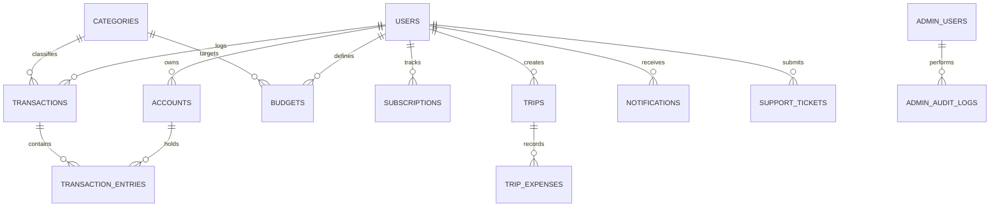

# 08. POSTGRESQL DATABASE SCHEMA & MIGRATIONS

**Document ID:** BN-ONE-DB-008  
**Version:** 1.0.0  
**Effective Date:** 2026-10-24  

---

## 1. Migration Manifest

The database architecture is version-controlled via 9 sequential migration files located in `database/migrations/`:

| Migration File | Primary Tables Created / Modified | Purpose |
|---|---|---|
| `000001_create_users_table.up.sql` | `users`, `user_sessions` | Core identity, hashed credentials, base currency, status |
| `000002_create_accounts_table.up.sql` | `currencies`, `accounts` | ISO-4217 currencies, manual asset & liability ledgers |
| `000003_create_transactions_table.up.sql` | `categories`, `transactions`, `transaction_entries` | Transaction records, split entries, minor units |
| `000004_create_budgets_table.up.sql` | `budgets` | Monthly category limits, alert thresholds |
| `000005_create_subscriptions_table.up.sql` | `subscriptions` | Recurring bills, billing frequencies, next due dates |
| `000006_create_forex_table.up.sql` | `fx_providers`, `exchange_rates` | Reference exchange rate feeds and timestamped cache |
| `000007_create_travel_table.up.sql` | `trips`, `trip_members`, `trip_expenses` | Travel workspaces, budgets, and multi-currency logs |
| `000008_create_notifications_and_support_table.up.sql` | `notifications`, `support_tickets`, `support_messages` | In-app notification center and support helpdesk |
| `000009_create_admin_and_audit_table.up.sql` | `admin_roles`, `admin_users`, `admin_audit_logs`, `feature_flags`, `deletion_requests` | RBAC back-office, immutable audit logs, GDPR queues |

---

## 2. Core Entity-Relationship Diagram

---

## 3. Data Integrity & Minor Unit Precision

1. **Monetary Columns:** Defined as `BIGINT NOT NULL DEFAULT 0`.
2. **Account Balances:** Calculated atomically using database transactions (`SELECT ... FOR UPDATE` or transactional balance updates).
3. **Foreign Keys:** All secondary tables enforce foreign keys pointing to `users(id)` with cascading or protected constraints (`ON DELETE CASCADE`).
4. **Audit Immutability:** The `admin_audit_logs` table has no `UPDATE` or `DELETE` API handlers, ensuring an append-only verifiable audit trail.

