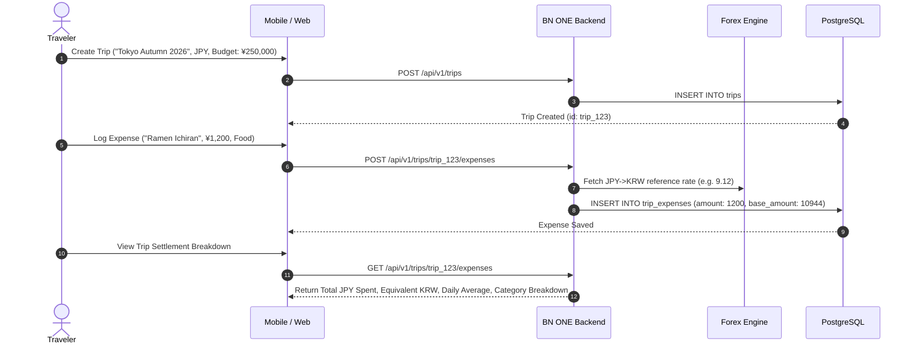

# 18. TRAVEL EXPENSE & TRIP WALLET SYSTEM SPECIFICATION

**Document ID:** BN-ONE-TRV-018  
**Version:** 1.0.0  
**Effective Date:** 2026-10-24  

---

## 1. Concept & Travel Persona Alignment

For modern international travelers, managing foreign spending is traditionally fractured across physical cash receipts, foreign currency credit cards, and mental exchange rate conversions.

BN ONE introduces dedicated **Trip Workspaces** designed to isolate travel spending from regular home monthly budgets, offering clear insight into trip burn rates and multi-currency expense settlements.

---

## 2. Core Functional Workflow

---

## 3. Data Model & Settlement Capabilities

1. **Trip Workspace Metadata:** Destination country, start/end dates, target trip currency, total trip budget.
2. **Multi-Currency Logging:** User can log expenses in the local foreign currency (e.g., JPY, EUR, USD, THB) while the engine automatically computes the home currency equivalent using historical or current reference exchange rates.
3. **Trip Settlement Report:** Generates a post-trip summary detailing total spending by category (Dining, Lodging, Transit, Sightseeing, Shopping), daily spend burn rates, and budget variance (surplus / deficit).
