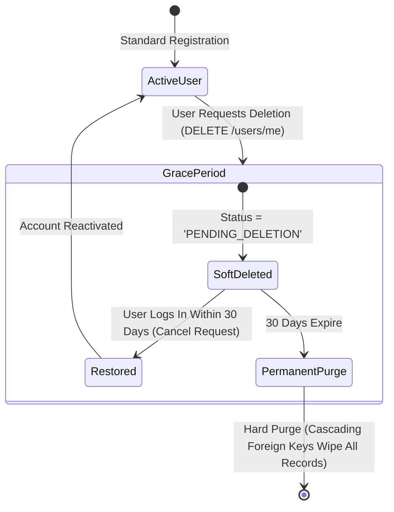

# 21. DATA EXPORT AND ACCOUNT DELETION SPECIFICATION

**Document ID:** BN-ONE-DEL-021  
**Version:** 1.0.0  
**Effective Date:** 2026-10-24  

---

## 1. Regulatory Context (GDPR Art. 17/20 & PIPA Art. 36/37)

Users possess full sovereign ownership over their financial records. BN ONE guarantees transparent self-service mechanisms to export all personal data in machine-readable formats and execute irrevocable account deletion.

---

## 2. Self-Service Data Export Engine

### 2.1 Supported Export Formats
- **Standard CSV Archive:** Structured CSV export including:
  - `accounts.csv`: Account names, types, currencies, balances.
  - `transactions.csv`: Date, category, type (income/expense/transfer), amount, minor units, notes.
  - `subscriptions.csv`: Service names, monthly amounts, billing cycles.
  - `trips.csv`: Trips, foreign expenses, converted home values.
- **Machine-Readable JSON:** Full nested hierarchical object export for power users and automated backup systems.

### 2.2 Endpoint & Workflow
- `GET /api/v1/users/export`: Streaming endpoint delivering an authenticated zip or CSV bundle directly to the user's browser or mobile device.

---

## 3. Account Deletion Lifecycle

### 3.1 Grace Period (Soft Deletion)
- Account immediately enters `PENDING_DELETION` status.
- User sessions are invalidated. The user is logged out of all active mobile and web sessions.
- If the user re-authenticates within 30 calendar days, they are prompted to restore their account.

### 3.2 Permanent Hard Purge
- After 30 days, the scheduled background worker (`services/worker/internal/privacy`) executes a database deletion.
- All associated records in `transactions`, `transaction_entries`, `accounts`, `budgets`, `subscriptions`, `trips`, and `notifications` are permanently deleted via database cascading constraints (`ON DELETE CASCADE`).
- Data cannot be recovered after this purge has executed.
